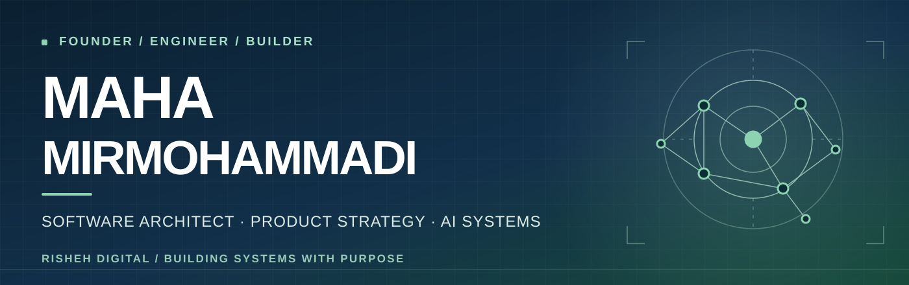
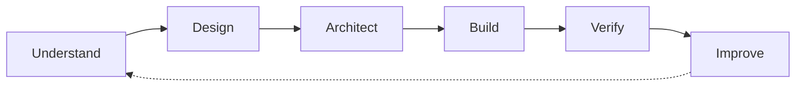

 

**Founder of [RISHEH Digital](https://rishehcompany.ir) · Software Architect · Product Builder**

I turn complex business problems into clear products, connected systems, and practical AI workflows.

[**Website**](https://rishehcompany.ir) &nbsp;·&nbsp; [**Selected work**](#selected-work) &nbsp;·&nbsp; [**Engineering approach**](#how-i-build) &nbsp;·&nbsp; [**Explore repositories**](https://github.com/mahamirmh?tab=repositories)

---

## Hello, I'm Maha.

I'm a **software engineer, product strategist, and founder** who enjoys moving between the big picture and the engineering details.

At **RISHEH Digital**, I help shape software products and the systems around them: from discovery and user experience to architecture, data, automation, AI integration, and delivery. I care about making technology useful to the people and teams who rely on it.

> **I don't build technology for its own sake. I build systems that make complicated work feel simpler.**

<table>
<tr>
<td width="33%" valign="top"><b>01 / Think in products</b>  Start with the real user, the business context, and a problem worth solving.</td>
<td width="33%" valign="top"><b>02 / Engineer for change</b>  Choose clear boundaries, maintainable architecture, and dependable delivery.</td>
<td width="34%" valign="top"><b>03 / Make AI accountable</b>  Use intelligent automation with evidence, permissions, human oversight, and measurable value.</td>
</tr>
</table>

## Selected work

These repositories show the range of products and engineering directions I'm building. **A repository is not a claim of production readiness**; demos, evolving platforms, and concepts are labeled accordingly.

### Products and engineering systems

| Project | The problem it tackles |
| :-- | :-- |
| **[RISHEH Core](https://github.com/mahamirmh/Risheh-Core)** | A connected internal workspace for company operations, engineering, knowledge, and collaboration. |
| **[MySchoolPlatform · Hamyar School](https://github.com/mahamirmh/myschoolplatform)** | Multi-tenant school operations, identity, learning workflows, and administration. |
| **[Engineering Control Plane](https://github.com/mahamirmh/risheh-engineering-control-plane)** | Evidence-driven software quality, security checks, and release governance. |
| **[Omnichannel Commerce Agent](https://github.com/mahamirmh/woocommerce-telegram-bot)** | Multi-tenant WooCommerce workflows across messaging channels; production readiness is evidence-gated. |
| **[RISHEH AI Platform](https://github.com/mahamirmh/Risheh-AI-Platform)** | Shared contracts and governed infrastructure for agents, tools, knowledge, and workflows. |

### Product exploration

| Project | Current direction |
| :-- | :-- |
| **[RISHEH Pulse](https://github.com/mahamirmh/Risheh-Pulse)** | A client collaboration portal; the published repository describes a **UI demo**, not a live operational platform. |
| **[AI Health Passport](https://github.com/mahamirmh/AI-Health-Passport-Platform)** | A **product concept** for organizing personal health information with privacy-first, clinician-friendly design. |

<a href="https://github.com/mahamirmh?tab=repositories"><b>Browse more engineering work →</b></a>

## The toolkit

My stack changes with the problem. These are some of the tools and disciplines I work with:

**Software & data**  

**AI, systems & delivery**  

`Product discovery` · `Systems architecture` · `Automation` · `Security` · `Testing` · `Observability`

## How I build

**Clarity before complexity. Evidence before confidence. Maintainability before hype.**

Good engineering isn't just making something work once. It's creating a product that people can understand, operate, improve, and trust.

## Beyond the current build

I'm especially curious about:

- **Agentic engineering:** useful AI agents with explicit boundaries and real quality gates.
- **Product intelligence:** better decisions through thoughtful data and operational design.
- **HealthTech & clinical research:** responsible applications at the intersection of healthcare, AI, and human-centered products.
- **Founder-led product building:** turning promising ideas into useful systems and sustainable businesses.

## Let's connect

I enjoy conversations with people working on **meaningful products, hard engineering problems, AI systems, and long-term collaborations**.

[**RISHEH Digital**](https://rishehcompany.ir) &nbsp;·&nbsp; [**GitHub**](https://github.com/mahamirmh) &nbsp;·&nbsp; [**Industry portfolio**](https://github.com/mahamirmh/RISHEH-Industry-Solutions-Corporate-Profile)

 

Built with intention. Designed to evolve. © Maha Mirmohammadi

