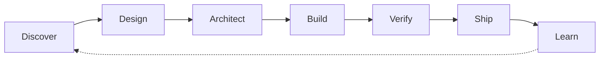

<div align="center">


<br/>

<a href="https://github.com/mahamirmh"></a>

### Curious mind. Architect's mindset. Builder's heart.

I turn complicated ideas into thoughtful products — and scattered business processes into systems that actually work.

**Founder @ [Risheh](https://www.rishehcompany.ir)** · Software Architect · Product Engineer · AI Builder

[](https://github.com/mahamirmh?tab=repositories)
[](https://www.rishehcompany.ir)
[](https://github.com/mahamirmh/RISHEH-Industry-Solutions-Corporate-Profile)

<sub>Product thinking × Systems engineering × Intelligent automation</sub>

</div>

---

## 01 / The person behind the systems

I'm **Maha** — a software engineer, product architect, endlessly curious builder, and the founder of **Risheh**. I love creating order from complexity: connecting people, ideas, operations, and technology into products that feel simple on the outside and are thoughtfully engineered inside.

My work lives where **product, engineering, data, and AI** meet. I enjoy taking a messy operational problem, finding its underlying structure, and designing something that teams can actually run, evolve, and trust.

> **I don't believe in random growth. I believe in intentional systems.**

| What I care about | How I approach it |
| :--- | :--- |
| **Product clarity** | Understand the business problem before selecting the technology. |
| **Clean architecture** | Design boundaries and contracts that remain maintainable as teams grow. |
| **AI that works** | Put agents inside reliable workflows with permissions, observability, and human oversight. |
| **Automation with purpose** | Replace repetitive operations without losing control or auditability. |
| **Production quality** | Security, testing, usability, performance, and operational resilience are part of the product. |

## 02 / Building at Risheh

**Risheh** is focused on connected digital business systems — not isolated websites, dashboards, or bots.

```text
Business challenge
      ↓
Discovery & product strategy
      ↓
UX / system architecture
      ↓
Software + data + integrations
      ↓
AI agents & automation
      ↓
Deployment, measurement & evolution
```

**The fields we work across**

`AI & Agentic Systems` · `Business Automation` · `Product Engineering` · `CRM & Operations` · `E-commerce` · `Data Platforms` · `Developer Experience`

## 03 / Selected engineering work

A selection of repositories, grouped by the problems they address — rather than a wall of technology logos.

<table>
<tr>
<td width="50%" valign="top">

### 🧠 AI & engineering intelligence

**[Engineering Control Plane](https://github.com/mahamirmh/risheh-engineering-control-plane)**  
Engineering orchestration and governance.

**[Engineering Agent](https://github.com/mahamirmh/risheh-engineering-agent)**  
Agent-assisted development workflows.

**[AI Developer Skills](https://github.com/mahamirmh/risheh-claude-skills)**  
Reusable engineering knowledge and tooling.

</td>
<td width="50%" valign="top">

### ⚙️ Automation & operations

**[N8N Workflows](https://github.com/mahamirmh/N8N-WORKFLOW)**  
Business process automation experiments.

**[WooCommerce Telegram Bot](https://github.com/mahamirmh/woocommerce-telegram-bot)**  
Commerce-to-messaging integration.

**[Risheh CRM](https://github.com/mahamirmh/CRM-RISHEH)**  
Customer and operational workflows.

</td>
</tr>
<tr>
<td width="50%" valign="top">

### 🧩 Prototyping & product systems

**[Prototype Factory Skill](https://github.com/mahamirmh/Risheh-Prototype-Factory-Skill)**  
A repeatable path from briefs to prototypes.

**[Rapid Prototype Standard](https://github.com/mahamirmh/Risheh-Rapid-Prototype-Standard-RRPS)**  
Standards for consistent product exploration.

**[Growth Intelligence](https://github.com/mahamirmh/Risheh-Growth-Intelligence)**  
Product-led growth research and workflows.

</td>
<td width="50%" valign="top">

### 🏢 Platforms & industry solutions

**[Risheh Core](https://github.com/mahamirmh/Risheh-Core)**  
Internal workspace and engineering operations.

**[Entekhab Platform](https://github.com/mahamirmh/Entekhab-Platform)**  
Content and service platform architecture.

**[Industry Solutions Profile](https://github.com/mahamirmh/RISHEH-Industry-Solutions-Corporate-Profile)**  
Industry-focused presentation of digital solutions.

</td>
</tr>
</table>

<sub>These links showcase engineering directions and repository work; they do not imply that every project is publicly deployed or production-ready.</sub>

<div align="center">

**[→ Explore all repositories](https://github.com/mahamirmh?tab=repositories)**

</div>

## 04 / The toolkit

**Languages & foundations**  
  

**Product & application engineering**  
   

**AI, orchestration & delivery**  
   

<sub>Tools are implementation choices, not the definition of the product.</sub>

## 05 / How I take an idea to production



The best outcome isn't a clever demo. It's a system with a clear purpose, a path to production, and a team that can maintain it.

## A little more human

I care about the small details as much as the big picture: a clear product narrative, a graceful interaction, an understandable system, a workflow that gives people their time back.

I enjoy researching new ideas, learning across disciplines, and exploring where **technology, product management, and healthcare** can meaningfully meet.

I want the things I build to be **useful, elegant, responsible — and genuinely human-centered**.

## 06 / What I'm curious about next

- **Agentic software engineering** — agents that operate within real engineering constraints.
- **Product & platform intelligence** — using data to improve decisions and execution.
- **HealthTech + AI** — meaningful, carefully designed applications at the intersection of technology and healthcare.
- **Developer tools** — making complex work more legible and repeatable.

---

<div align="center">

### Have a complex problem worth building for?

I’m always interested in thoughtful conversations about architecture, products, intelligent systems, and long-term technical partnerships.

**[GitHub](https://github.com/mahamirmh)** · **[Risheh](https://www.rishehcompany.ir)** · **[Explore the portfolio](https://github.com/mahamirmh/RISHEH-Industry-Solutions-Corporate-Profile)**

<br/>


<sub>Designed with intention · Built for evolution</sub>

</div>
